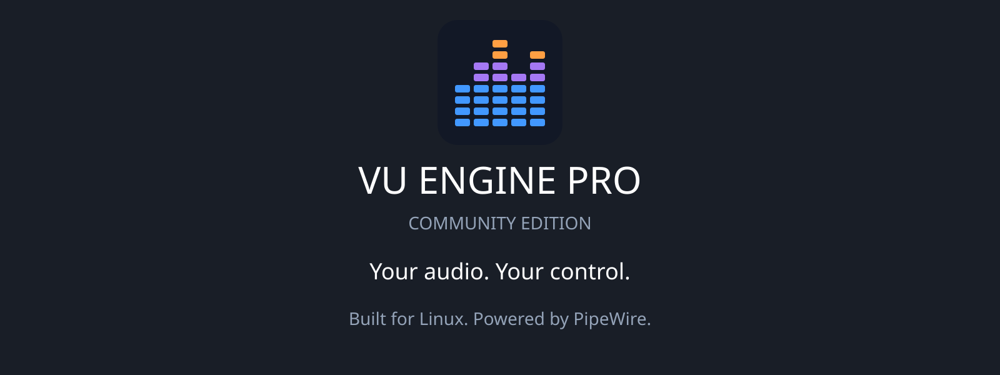
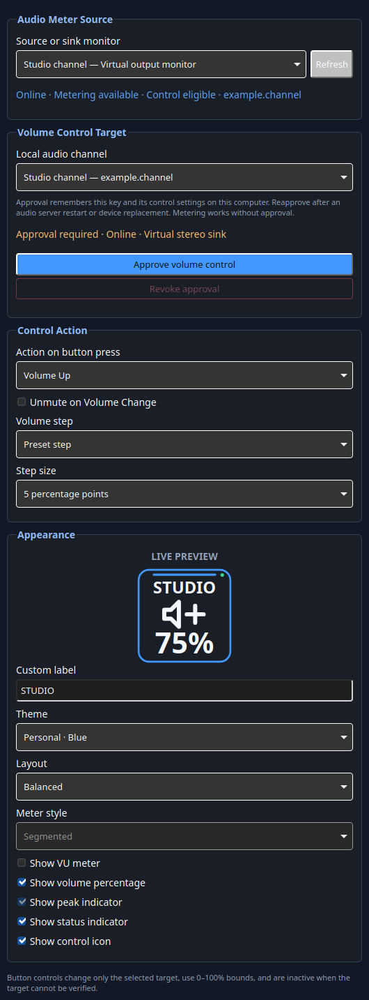

# VU Engine Pro
**Your audio. Your control.**

Advanced real-time audio metering and volume controls for OpenDeck on Linux, powered by PipeWire.

**2.4.0 Community Edition · Pre-release candidate · Developer: CodeX**

Turn a key into a stereo activity meter, a gain control, or both. In the Clean Layout, the plus and minus keys show the current gain and the mute key shows the audio signal. Choose the source and the control target separately. PipeWire Controller is optional.

## Configure your first key

1. Follow the [installation guide](docs/Installation.md). This candidate awaits installation verification on a separate host.
2. Add **PipeWire VU Meter**. Choose an **Audio Meter Source** and leave the control action on **None**. The meter uses RMS, peak hold and falloff. Visible meters on the same source share a capture.
3. For a gain key, choose an eligible individual stereo sink, set the button action and click **Approve volume control** last. Approval follows the same host key context and control configuration across appearances and plugin restarts within the current audio session. Imported profiles carry no permissions.
4. Pick Balanced, Meter Focus or Minimal, select a theme or custom accent, and choose a segmented or continuous meter. The inspector previews your key with the same renderer used by OpenDeck.

## Using the candidate

- [Configuration and example profiles](docs/Configuration.md)
- [Requirements and target compatibility](docs/Compatibility.md)
- [Troubleshooting](docs/Troubleshooting.md)
- [Changes](CHANGELOG.md), [contributing](CONTRIBUTING.md) and [security](SECURITY.md)

CodeX develops this independent plugin with AI assistance. OpenDeck, OpenAction, WirePlumber, PipeWire and Elgato are separate projects or products.

[Optional virtual audio channel](docs/Virtual-channel.md) · [Inspector after approval](screenshots/inspector-approved.png) · [Offline inspector](screenshots/inspector-offline.png)

The current candidate requires Python 3.10+ and bundles the pure-Python synchronous client from websockets 16.0 (BSD-3-Clause). See [third-party notices](THIRD_PARTY_NOTICES) and the [updated control icon sheet](screenshots/control-icons-2.4.png).

## ❤️ Support the Project

VU Engine Pro is free and open-source software.

If you enjoy using VU Engine Pro and would like to support its continued development, you can make a voluntary contribution via PayPal.

[Support VU Engine Pro via PayPal](https://paypal.me/cod3xgaming)

Your support helps fund development, maintenance, and future improvements.

Every contribution is appreciated, but never required.

Thank you for supporting independent Linux software!

— CodeX

## License

Original contributions are distributed under the [MIT license](LICENSE), copyright (c) 2026 CodeX. Bundled websockets 16.0 retains its BSD-3-Clause license. See the [provenance record](docs/Provenance.md).
